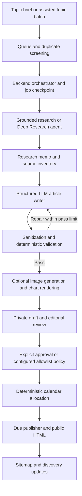

# Auto Blogging — Functional Requirements Specification (FRS)

| Document control | Value |
| --- | --- |
| Document ID | AB-FRS-001 |
| Version / date | 1.0 / 14 October 2026 |
| Status | Draft specification; implementation and deployment must be verified separately |
| Traceability | [URS](AUTO_BLOGGING_URS.md), [Model report](AUTO_BLOGGING_MODEL_REPORT.md) |

## 1. Interpretation and current architecture

This FRS defines required system behavior for the URS. **B** means a baseline code path was inspected; **E** means a proposed enhancement; **M** means a baseline exists but the full requirement extends it. No label asserts passing runtime tests. All requirements are mandatory for the complete specified release unless identified as Should in the URS.

The inspected system uses Firebase Authentication for admin access, HTTP Cloud Functions for administration and public rendering, Firestore for state, scheduled functions for dispatch/poll/publication, Cloud Storage for visuals, and Secret Manager plus encrypted credential overrides for provider access. The admin interface is `admin-blog-agent.html`; manual editing and authors are managed through `admin-blog.html`.

The diagram describes logical responsibility. In the current code a draft receives a provisional slot at insertion; approval can schedule or adjust it. Approval and due-time checks remain publication prerequisites.

## 2. Administration, settings, and queue

| ID | Required behavior | Evidence | URS |
| --- | --- | --- | --- |
| FRS-01 | Verify the Firebase bearer token and admin authorization on every admin data/action request. Return unauthorized responses without protected data. Use no-store responses and allowed-origin handling. | B | 01, 18 |
| FRS-02 | Show queue, active jobs, draft/publication counts, authors, calendar, provider status, and job details. Credentials shall be represented by status only. | B | 01, 15 |
| FRS-03 | Validate and store title, brief, cluster, target query, and bounded priority. Reject a topic with no usable title/query. Screen normalized query/title similarity against existing topics and posts; expose the duplicate decision. | M | 02, 03 |
| FRS-04 | Support manual start, skip, requeue, and assisted topic refill. Automatic refill requires enabled dispatch, enabled replenishment, and an exhausted pending/researching queue. Use a transactional refill lock and post-generation duplicate screening. | B | 03, 04 |
| FRS-05 | Validate independent research/writing/image profiles and Custom overrides; expose effective models and limits before save. Snapshot effective generation settings per job. Extend the snapshot to prompt versions, schema version, fallback settings, and price version for reproducibility. | M | 07, 15, 17 |
| FRS-06 | Default dispatch, automatic refill, and automatic approval off. Support a separate publication pause that is checked immediately before a publish mutation; turning dispatch off alone shall not imply a publication pause. | M | 04, 09, 19 |

Baseline defaults: two active jobs, one topic per dispatch batch, three maximum job attempts, quality threshold 85, Asia/Karachi, Monday/Wednesday/Friday at 10:00, and one post per publishing day. These are configuration defaults, not production assertions. Topic refill defaults to ten ideas; the UI permits a batch of three to twenty. Schedule settings permit one to three slots per publishing day.

## 3. Agentic orchestration and LLM incorporation

### 3.1 Roles and authority

| Component | Inputs → outputs | Allowed authority | Evidence |
| --- | --- | --- | --- |
| Topic curator | Allowed groups, inventory, editorial context → structured topic briefs | Propose queue items through validated server ingestion | B |
| Research agent / grounded pass | Brief, query, research policy → memo, source URLs, usage, provider operation ID | Read approved public sources using configured provider tools; bounded research | B |
| Article writer | Memo, sources, approved links, brand rules, schema → structured article JSON | Generate a draft payload only | B |
| Revision loop | Draft and deterministic errors → corrected complete payload | Retry within the writing-pass limit | B |
| Claim verifier | Material claims and source evidence → support/conflict/unknown findings | Flag issues and block editorial release; never grant approval itself | E |
| Visual generator | Approved visual plan → hero/supporting assets and metadata | Generate and store approved asset types | B |
| Calendar ranker | Eligible unpublished posts → ordered post IDs and reasons | Recommend order only; server allocates legal slots | B |
| Orchestrator / publisher | Stored states, policy, schedule → checkpoints and publication | Sole authority for state mutation, approval enforcement, and publication | B |

These are logical roles and may run sequentially in the same backend. The existing system does not require a separate autonomous process, an agent framework, a vector database, or model fine-tuning for each role. Durable context is the topic, research memo, source inventory, article payload, and job checkpoints. Optional retrieval of private company material would need a separately scoped design.

### 3.2 Provider interfaces and safeguards

| ID | Required behavior | Evidence | URS |
| --- | --- | --- | --- |
| FRS-07 | Route normal research to Gemini grounded generation or Gemini Deep Research. Store asynchronous interaction IDs, poll unfinished work, and retain memo plus sources on completion. Existing OpenAI research retrieval may resume legacy jobs; it is not the normal research preset. | B | 05, 07, 16 |
| FRS-08 | Route writing to OpenAI or Gemini with the article schema. Treat refusal, truncation, empty output, invalid JSON, and schema mismatch as explicit failures; do not insert partial articles. | M | 06, 16 |
| FRS-09 | Apply bounded validation/repair passes; retain failed checks and usage for every pass. Do not repair indefinitely or lower quality gates to make a job pass. | M | 06, 15, 17 |
| FRS-10 | Permit only configured provider tools and public source retrieval. Treat source text as untrusted evidence; it cannot change system instructions, credentials, tool permissions, budget, approval, or schedule. If server-side fetching is introduced, block private-network destinations and validate redirects. | E | 05, 18 |
| FRS-11 | Record requested and actual model/provider, operation/request IDs where available, fallback reason, usage, duration, and stage outcome. Require compatible structured output and modality before a fallback is eligible. Apply the same validation and remaining budget. | M | 07, 15, 17 |
| FRS-12 | For material factual claims, store supporting source/evidence, dates where relevant, and unresolved contradictions. No usable sources or unresolved critical claims shall block approval. A URL matching the research inventory is not evidence that the claim is true. | E | 05, 09, 20 |

The current writer fallback handles OpenAI connection errors by using a configured Gemini model. A general fallback for all refusals, rate limits, bad credentials, or unsupported models is not established. The target design shall classify failures: retry transient 429/5xx/connection issues with bounded exponential backoff and jitter; fail authentication/configuration issues with an operator action; hold content-policy refusals for review. Provider-supported retry timing takes precedence.

## 4. Data and state model

### 4.1 Persistent records

| Record | Baseline location | Required contents / extensions |
| --- | --- | --- |
| Settings | `blog_agent_settings/global` | Automation, profiles, provider/model IDs, prompts, concurrency, retries, author, timezone, days, slots, quality threshold; E: budgets and publication pause |
| Topic | `blog_agent_topics` | Brief, query, cluster, priority, editorial status, active job, result post, timestamps |
| Job | `blog_agent_jobs` | Topic ID, stage/status, operation ID, attempts, lock expiry, profile, memo, article checkpoint, visuals, validation, token totals, post ID; E: stage ledger and complete version snapshot |
| Sources / logs | `blog_agent_jobs/{job}/sources` and `/logs` | Source URL/title; redacted activity and failures; E: retrieved/published dates and claim evidence |
| Article | `blog_posts` | Slug/title/body, direct answer, FAQs, references, SEO fields, author ID, visuals, quality, provenance, schedule, approval and public status; E: content revision/hash and approved revision |
| Authors | `blog_authors` | Existing author profiles selected by configured ID |
| Coordination | `blog_agent_locks/topic_replenishment`; `blog_agent_reschedule_proposals` | Refill exclusion; proposed calendar, expiry, schedule signature, and affected records |
| Audit | `blog_agent_events` | Actor, action, entity IDs, time, outcome, redacted metadata, expiry |
| Sitemap | `site_artifacts/sitemap` | XML, hash, counts, refresh reason |
| Credential override | Managed by `credentials.js` | Encrypted provider keys; encryption key held separately in Secret Manager |

E means a proposed extension. Exact credential storage details remain encapsulated by the credential store. Never include plaintext keys in article, job, or audit records.

### 4.2 State transitions

Keep job, topic, and article states distinct:

- **Topic:** `pending → researching → review_ready → approved → published`; failures may produce `failed`, `skipped`, or `archived`; explicit requeue returns eligible work to `pending`.
- **Job:** `dispatching → polling → research_done → writing → validating → imaging → inserted`. Grounded research may complete without prolonged polling; image-off bypasses image generation. `ready` is also a declared job status. Exact stored transitions depend on checkpoint completion; no new enum is implied by this logical sequence.
- **Article:** `status=draft` with `approvalStatus=pending_review`; approval permits scheduling/publication; rejection remains non-public; successful publication sets `status=published`. Job `inserted` means a draft exists, not that it is approved or live.

**FRS-13 (M; URS-16):** Claim topics and jobs transactionally, use expiring leases, and persist completion checkpoints before progressing. A completed-job-to-post transaction shall insert at most one post. Target acceptance shall also verify that duplicate dispatches do not start duplicate paid research calls and that concurrent workers do not allocate conflicting slots; existing locks alone do not prove those properties.

**FRS-14 (E; URS-11, 18):** Maintain a monotonically increasing content revision or content hash. Approval shall bind to the reviewed revision. Editing body, material metadata, sources, author, or visuals shall clear approval and trigger applicable validation. At publication, approved revision shall equal current revision.

## 5. Structured article contract

**FRS-15 (B; URS-06):** Require a structured article object using the schema in `prompts.js`; normalize and sanitize before storage. The logical contract includes:

| Group | Fields |
| --- | --- |
| Identity | `title`, `slug`, `excerpt`, `metaDescription` |
| Main content | `directAnswer`, `contentHtml`, `faqs[{question, answer}]` |
| Research | `references[{title, url}]` |
| Search context | `primaryKeyword`, `secondaryKeywords`, `searchIntent`, `entities`, `tags` |
| Visual intent | `imagePrompt`, `imageAlt`, `visualPlan` including supporting visual and accessible chart plan |
| Backend-owned metadata | Author attribution, status, approval, timestamps, provider provenance, assets, job/topic IDs, quality report |

Backend-owned fields shall not be accepted as publication authority from generated JSON. Normalize slugs, enforce uniqueness, and use approved internal links. Preserve source inventory separately from displayed references.

## 6. Validation, images, and editorial review

**FRS-16 (B; URS-06):** Apply these inspected deterministic content rules. Warnings and errors shall remain separate:

| Check | Required rule |
| --- | --- |
| Body | At least 900 body words; writing prompts aim higher, commonly 1,200–1,500 words |
| Headings | At least four H2 headings; at least two answerable question headings; no body H1 |
| Direct answer | 35–90 words |
| Description | 150–160 characters |
| FAQs | Three to six question/answer pairs |
| Internal links | Three to five approved internal links, including at least one service URL; unknown internal links fail |
| References | At least two normalized references; when a research source inventory exists, references must match it |
| Scannability | At least one table and two lists; no paragraph above 120 words |
| Visual planning | Descriptive hero and supporting alt text, supporting prompt and section placement, chart placement and at least three chart items |
| Search fields | Primary keyword and search intent required |
| Warnings | Fewer than two tags or a title above 65 characters |

The baseline score is `max(0, 100 - 12 × error_count - 3 × warning_count)`. Passing requires zero errors; a configured minimum score is an additional gate. A numerical score cannot override a hard error. This score measures format and structure, not truth or writing effectiveness. The proposed source-presence check must close the case where an empty source inventory would otherwise allow normalized references.

| ID | Required behavior | Evidence | URS |
| --- | --- | --- | --- |
| FRS-17 | Sanitize generated HTML with an allowlist; strip scripts, event handlers, disallowed elements, and unsafe URL schemes. Escape generated metadata and JSON-LD appropriately. | B | 06, 18 |
| FRS-18 | Support image-off, a single reusable image, or distinct hero/supporting images. Render charts as accessible HTML from the validated plan. Reuse successful assets on retry and record generation model, alt text, and failure state. | B | 08, 16 |
| FRS-19 | Show preview, sources, validation, visuals, author, and schedule before approval. Approve individually or in a batch that reports approved and skipped/blocked counts. Reject with a reason. Revalidate edited content and protect approval with FRS-14. | M | 09, 11 |
| FRS-20 | Automatic approval requires global enablement, exact cluster allowlist membership, zero validation errors, score at/above threshold, and required visuals complete. Target release adds no unresolved critical evidence flags and revision-bound approval. | M | 10 |

Charts shall not invent measured statistics. Illustrative comparisons must be labelled as illustrative, and factual numeric charts must identify their evidence. Image generation shall not create fabricated screenshots, certifications, customer outcomes, or other false evidence. These editorial checks extend the structural baseline.

## 7. Calendar, publication, and public delivery

| ID | Required behavior | Evidence | URS |
| --- | --- | --- | --- |
| FRS-21 | Validate IANA timezone, weekdays, distinct daily times, and daily limit; store instants as timestamps and render in the selected timezone. Allocate the next legal unoccupied slot with the baseline one-hour minimum lead. If no slot exists in the search horizon, report failure rather than inventing a time. | B | 12 |
| FRS-22 | Preview smart rescheduling using model-proposed order and deterministic slot assignment. Freeze published and imminent posts within six hours. At apply, reject expired/stale proposals and changed settings or affected records; never let generated ranking mutate publication itself. | B | 14 |
| FRS-23 | Publish only a draft with approved status and `scheduledAt <= now`. Recheck eligibility in the final mutation. Target release also checks publication pause, content revision, hard quality failures, and required visuals. Repeated publisher execution shall not duplicate publication. | M | 09–13, 16, 19 |
| FRS-24 | Return complete initial HTML at `/blog/{slug}.html` for published articles, with canonical, social metadata, BlogPosting, BreadcrumbList, and matching FAQ content/schema. Draft/unknown slugs shall not expose content. Refresh sitemap on publish, update, or unpublish, and record/retry discovery failures independently. | M | 13, 18 |

Baseline schedules are dispatch every five minutes, polling every two minutes, publication every five minutes, and log cleanup daily. Scheduler cadence is not a guaranteed completion time: provider duration, queue depth, quotas, and runtime failures affect latency. Current sitemap and IndexNow components support discovery; submission is not a guarantee of crawling, indexing, or ranking. Existing RSS support is ancillary to the core publication requirements.

## 8. Admin API surface

The existing logical endpoint is `/api/admin/blog-agent`, routed to `blogAgentAdmin`. GET returns the dashboard; `?view=job&id=...` returns job detail. POST uses an `action` discriminator:

| Function | Actions |
| --- | --- |
| Queue | `create_topic`, `dispatch_topic`, `replenish_topics`, `skip_topic`, `queue_topic` |
| Settings/security | `save_settings`, `save_credentials` |
| Worker recovery | `run_poll`, `retry_job` |
| Review/visuals | `approve_post`, `approve_all_posts`, `reject_post`, `regenerate_visuals` |
| Calendar | `preview_future_reschedule`, `apply_future_reschedule` |
| Publication | `run_publish` |

**FRS-25 (M; URS-01, 15, 18):** Validate identifiers and payloads server-side; reject unknown actions; return success identifiers/counts or actionable redacted errors. The inspected handler uses 401 for denied auth, 405 for unsupported methods, and 400 for unknown actions or handled failures. Typed validation/conflict/provider errors and a correlation ID are proposed improvements; this document does not imply a new API is already available.

## 9. Cost accounting, security, and recovery

| ID | Required behavior | Evidence | URS |
| --- | --- | --- | --- |
| FRS-26 | Persist a stage/call ledger: actual provider/model, input/cached/output tokens, reasoning billing treatment, tool/search usage, assets, retries, duration, pricing version, and cost status. Avoid double counting cumulative research usage or replayed callbacks; missing usage is unknown, never zero. Reconcile estimates with provider billing. | E | 15, 17, 20 |
| FRS-27 | Configure per-job and monthly spend limits. Atomically reserve a conservative stage allowance before a paid call, settle actual usage afterward, and block calls exceeding remaining budget. Account for concurrent jobs and fallback exposure. Provider-side limits and bounded calls are also needed because in-flight agent spend cannot always be stopped precisely. | E | 17, 19 |
| FRS-28 | Encrypt browser-entered keys with AES-256-GCM; keep encryption material in Secret Manager; use server secrets as configured fallback. Redact credentials, auth headers, raw prompts, and article bodies from audit events. Deny public access to private records. | M | 18 |
| FRS-29 | Retain audit events and new per-job logs for 30 days and delete expired records in bounded cleanup batches. Source/article retention is separate; do not imply log cleanup removes article provenance. Define backup/restore, source retention, deletion, and provider data-handling policies before release. | M | 15, 18 |
| FRS-30 | Recover from expired leases and safe checkpoints; cap attempts and expose manual retry. Preserve completed research/article/assets when safe. Raise operator-visible failure for unsupported models, missing authors/keys, quota exhaustion, and repeated asset failures. | M | 15, 16 |
| FRS-31 | Compare candidate profiles on a fixed evaluation set and retain actual token, tool, acceptance, latency, and editor-effort data. Use the selection gates and formulas in the model report. | E | 20 |

A total-token counter exists in the baseline; a complete monetary ledger and transactional spending guard do not. Cloud billing alerts alone do not implement a hard application budget.

## 10. Verification and traceability

The following are required acceptance cases, not results executed during document preparation:

| Test | Scenario and expected result | FRS coverage |
| --- | --- | --- |
| AT-01 | Missing/invalid/non-admin identity cannot read dashboard, mutate settings, retrieve keys, or read draft content. | 01, 02, 25, 28 |
| AT-02 | Submit duplicate topics and run simultaneous refills; duplicates are excluded and one guarded batch is ingested. | 03, 04, 13 |
| AT-03 | Select profiles, dispatch a job, change settings, and resume; recorded job versions govern generation. | 05, 11 |
| AT-04 | Poll an unfinished research interaction, then complete it; one memo/source checkpoint appears with no duplicate billing aggregation. | 07, 13, 26 |
| AT-05 | Test invalid JSON, refusal, truncation, unsafe HTML, unknown links, insufficient references, and each quality boundary; errors block insertion/approval. | 08, 09, 12, 15–17 |
| AT-06 | Include source text that asks to expose keys or publish; it cannot change authority or access protected data. | 10, 28 |
| AT-07 | Fail one image after another succeeds; retry reuses the successful image. Image-off makes no image calls. | 18, 30 |
| AT-08 | Exercise single/batch approval, rejection, empty allowlist, wrong cluster, missing visuals, and low score. | 19, 20 |
| AT-09 | Edit approved content and trigger due publication; changed revision remains private until reviewed again. | 14, 19, 23 |
| AT-10 | Test timezone conversion including a DST-observing zone, full slots, search-horizon exhaustion, simultaneous allocation, stale reschedule proposals, and six-hour freeze boundaries. | 13, 21, 22 |
| AT-11 | Repeated/concurrent publisher ticks publish only due eligible articles once; a publication pause stops mutation. | 06, 23 |
| AT-12 | Public HTML, canonical and schema match published content; drafts stay private; sitemap retries recover a discovery update failure. | 24 |
| AT-13 | Race two paid stages against remaining budget; only affordable reservations proceed. Reconcile failed/fallback usage without double counting. | 26, 27 |
| AT-14 | Expire a lease, exhaust retries, omit an author, and remove provider access; each case gives a recoverable or terminal state without duplicate posts. | 13, 30 |
| AT-15 | Expired logs are cleaned; secrets remain absent from responses and audit; backup/restore retains approved article provenance. | 28, 29 |
| AT-16 | Run the fixed model pilot; report actual quality and total cost without labelling unrun candidates as winners. | 31 |

Existing test suites under `functions/blog-agent/test/` cover many individual components. Acceptance requires appropriate emulator integration and public-rendering checks in addition to those tests. Proposed operating targets are in URS section 6. No production changes, paid model experiments, or deployments are required merely to review these specifications.

## 11. Delivery gaps and release decisions

Highest-priority additions are claim evidence and no-source blocking, revision-bound approval, an independent publishing pause, complete stage usage/cost accounting, and concurrent budget reservations. Also verify dispatch/slot concurrency and fallback behavior, introduce full prompt/schema/profile snapshots, and confirm authorization/storage rules in the deployed environment.

Changing model presets is a separate implementation decision. First validate account access, API compatibility, article quality, refusal behavior, reasoning cost, and total accepted-article economics using the report. The current source presets remain unchanged by this specification.
