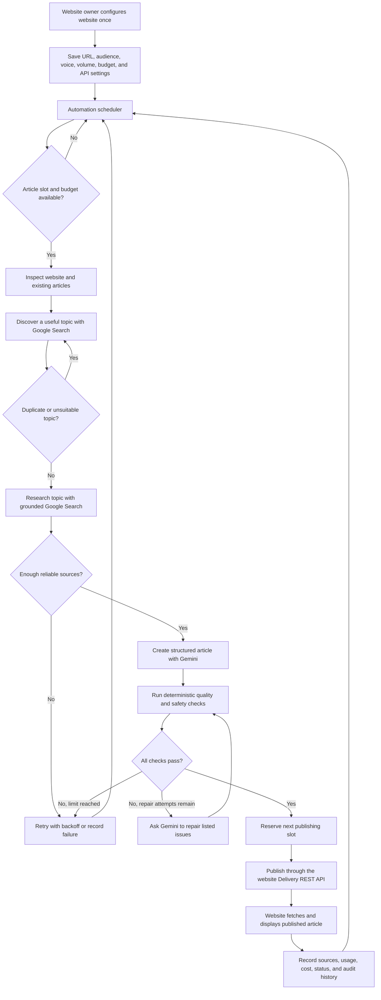

# AutoBlog Studio — Fully Automated Workflow

This diagram describes the intended no-human-input workflow for every configured website.

## Automation rules

- The scheduler runs the workflow independently for each enabled website.
- Queued topics take priority; otherwise the system discovers a topic from the website itself.
- Duplicate titles and previously used ideas are rejected before research.
- Research must provide usable sources before writing starts.
- Validation failures are repaired automatically within a bounded attempt limit.
- Temporary AI or search quota failures are retried automatically with backoff.
- The article is published automatically when it passes validation and its scheduled time arrives.
- Each external website integrates through the generic Delivery REST API.

